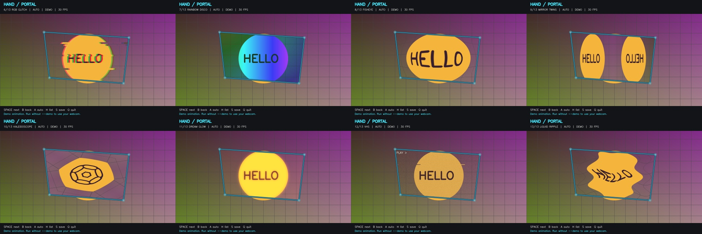

# Hand Portal

A Python webcam effect inspired by your reference: both thumbs and index fingers
hold the four corners of a moving filter window. Includes 13 switchable effects;
the default is animated RGB glitch. All effects stay inside the hand window.



## Run on Windows

### Browser frontend with Python backend

The desktop app is retained. The web interface uses the **same Python tracking,
gesture, and effects code**; it does not replace it with JavaScript filters.

Run `setup.bat` once if you have not already, then open PowerShell in the project:

```powershell
.\run_web.bat
```

Open **http://127.0.0.1:8000** and click **Start camera**. Allow the browser's camera
permission. Use **Try demo** to preview effects without a camera. Click an effect
or use the existing hand gesture to switch. **Stop** releases the camera and closes
the processing session. Snapshots download only when the save button is clicked.
Keep the terminal running; press Ctrl+C there to stop the server.

`run_web.bat` installs the extra web dependencies on first use. For manual setup:

```powershell
.venv\Scripts\python.exe -m pip install -r requirements-web.txt
.venv\Scripts\python.exe web_app.py
```

The browser sends mirrored JPEG frames over a same-origin WebSocket to FastAPI.
Python runs MediaPipe and OpenCV, then sends back the filtered frame and status.
Each browser session has separate tracking state. Only one frame is in flight per
browser to avoid a queue of stale video. Frame rate depends on CPU and image size.
No video frames are stored by the server. Demo mode uses synthetic frames and does
not test real hand detection.

The app can also be deployed to Vercel as a FastAPI Python Function. Import this
repository into Vercel and deploy with the project root as the root directory.
The build command downloads the MediaPipe model, which is intentionally excluded
from Git. The Vercel deployment serves the frontend and processes camera frames;
frames leave the browser and are sent to the hosted function. The app does not
store them. Only deploy it where you are comfortable processing camera data.

Vercel WebSockets are currently in public beta and close when a Function reaches
its maximum duration (300 seconds on Hobby). The browser reconnects automatically.
The default local server still binds only to `127.0.0.1`. Browsers allow camera
access on localhost or HTTPS; an HTTP LAN IP may not work. See [camera access
requirements](https://developer.mozilla.org/en-US/docs/Web/API/MediaDevices/getUserMedia),
[FastAPI WebSockets](https://fastapi.tiangolo.com/advanced/websockets/), and
[Vercel WebSockets](https://vercel.com/docs/functions/websockets).

### Desktop OpenCV window

Double-click **setup.bat** once (internet required for dependencies and the model),
then double-click **run.bat**. Setup creates a local `.venv`; it does not install
packages into your global Python environment. Requires 64-bit Python 3.10 or newer.

Hold both hands in front of the webcam. Form an L with each thumb and index finger,
with the thumbs pointing toward one another. Separate your hands to frame an area.
Move them to resize or tilt the effect. Keep all four fingertips visible and avoid
crossing your hands. **To change effects, lower either hand, fold an index finger,
or close a thumb/index gap for about half a second. Reopen the hand window to see
the next effect.** Hold the open window briefly (at least a quarter second) before
each switch. Holding your hands down advances only once. Brief detection dropouts
are ignored; a sustained tracking loss also counts as closing the hand window.
Bright, even lighting and a clear view of both hands help tracking.

Click the video window so it receives keyboard input:

| Key | Action |
| --- | --- |
| 1 | Neon hologram |
| 2 | Retro pixelation |
| 3 | Comic posterization |
| 4 | Thermal-style colors (visual filter, not temperature measurement) |
| 5 | Inverted colors, like the reference |
| 6 | Animated RGB glitch / color split |
| 7 | Animated rainbow disco |
| 8 | Fisheye magnification |
| 9 | Mirror twins |
| 0 | Rotating kaleidoscope (effect 10) |
| Space / N | Next effect, including 11 Dream Glow, 12 VHS, 13 Liquid Ripple |
| B | Previous effect |
| A | Switch between gesture control (default) and timed cycling |
| H | Show / hide the full effect list |
| S | Save a screenshot in `captures/` |
| Q / Esc | Exit |

Open PowerShell in the downloaded or cloned project folder:

```powershell
.\run.bat
```

The default is gesture control: lower a hand or close your fingers to advance.
You can keep an effect by keeping the hand window open. Keyboard selection also works.
Optional timed mode (`.\run.bat --auto`) advances every 5 seconds while the hand
window is visible and disables gesture switching. Press A to return to gestures.
For a faster timed cycle, use `.\run.bat --auto --interval 3`.
For an animated preview without a webcam, run `.\run.bat --demo --auto`.
For a different webcam, run `run.bat --camera 1`. Start on a specific filter with
`run.bat --effect 13`. Print the numbered list with `.\run.bat --list-effects`.
You can also run `.venv\Scripts\python.exe hand_tracker.py`.

## Effect references

These are original OpenCV implementations inspired by social camera effects,
not downloaded Instagram/TikTok effect packages or an integration with either app.
Visual references from TikTok's official Effect House documentation:

- [Chromatic Aberration](https://effecthouse.tiktok.com/learn/guides/workspace/components/post-effect/post-process/chromatic-aberration): color separation, used as inspiration for RGB Glitch.
- [Disco Party](https://effecthouse.tiktok.com/learn/guides/tutorials/template-tutorials/disco-party): rainbow party styling. Our Rainbow Disco animates on a timer; it does not use audio or person segmentation.
- [Post-process filter stack](https://effecthouse.tiktok.com/learn/guides/tutorials/apjs-api/post-process-filter-stack): bloom, distortion, and grain references for Dream Glow, Fisheye, and VHS.

Fisheye and Mirror Twins transform everything inside the window. They do not
detect individual facial features or add face-attached makeup/accessories.

If the camera will not open, close other apps using it and check Windows Settings
> Privacy & security > Camera > Let desktop apps access your camera. The app tries
multiple camera backends and reports a failure if it cannot read a frame.

Camera images are processed locally. The app itself does not upload video or record
it; snapshots are saved only when S is pressed. The trained model is downloaded
from Google on first setup and reused from `models/hand_landmarker.task`.

## How it works

Uses the [MediaPipe Hand Landmarker Tasks API](https://developers.google.com/edge/mediapipe/solutions/vision/hand_landmarker/python)
to locate fingertips. A convex polygon connects the four points, with time-based
smoothing to reduce jitter. OpenCV applies the chosen effect within the polygon.
The visible border and controls are drawn on top of the camera view.

The camera loop and detection are synchronous for simplicity. Actual frame rate
depends on your camera, CPU, lighting, and effect. `--demo` simulates the portal
geometry and does not test real hand detection.

Run automated geometry, masking, and model smoke checks with:

```powershell
.venv\Scripts\python.exe -m unittest discover -s tests -v
```

To include web endpoint and WebSocket tests, first install `requirements-dev.txt`.
The desktop tests still run without those optional packages.

With the web server running, `.venv\Scripts\python.exe scripts/verify_web.py`
runs the optional browser checks using installed Microsoft Edge and a synthetic
camera feed. It checks demo rendering, effect selection, timer mode, screenshots,
camera start/stop/restart, and mobile layout, and saves previews in `preview/`.
Real hand gestures still need a live webcam check.
